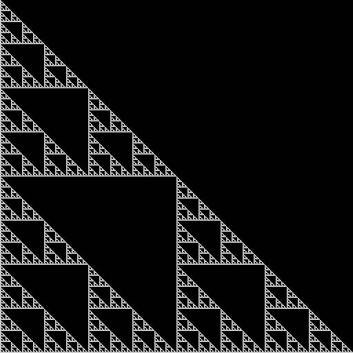
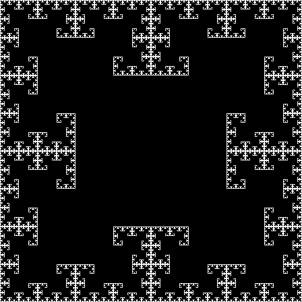
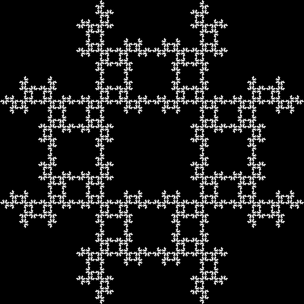
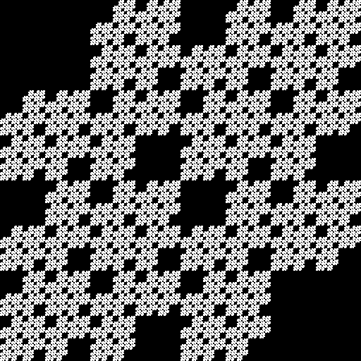
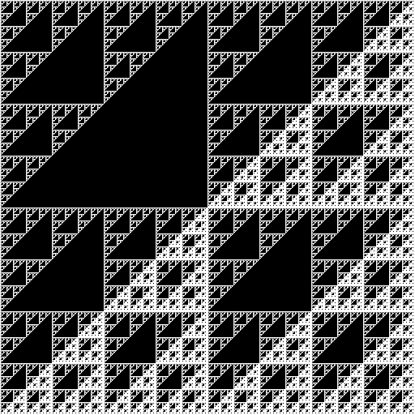

# fragex

**Regex fractals in OpenGL**



A square of side 2<sup>n</sup> is split into quadrants, numbered

```
0 1
2 3
```

and each quadrant again, down to single pixels, so every pixel has an address of n digits,
most significant quadrant first. Pixels whose address matches a regex are drawn black.

| `.*(12\|21\|03\|30).*` | `.*(.)\1.*` | `.*(00\|33).*` | `.*0.*3.*` |
|---|---|---|---|
|  |  |  |  |

Based on [regex fractals](http://www.reddit.com/r/compsci/comments/21ife7/regex_fractals_source_code/).

## Usage

```bash
fragex [regex] [--size N] [--save out.png]
```

- each line typed on stdin is a new regex
- Up/Down step through the presets and earlier regexes, Escape quits
- `--size` is the side in pixels, a power of two, default 512. Addresses have log2(size)
  digits, so a regex matching only even length addresses needs an even power, e.g. 1024
- `--save` renders offscreen, checks the OpenGL output against the CPU image and writes a
  black and white PNG instead of opening a window

## Build

With [Maiken](https://github.com/mkn/mkn), using [mkn.gl](https://github.com/mkn/mkn.gl) for
GLFW and GLEW:

```bash
mkn clean build -dtOp bin -a "-std=c++20 -fPIC" -l -pthread
./bin/bin/fragex ".*1.*"

# checks of the addressing and matching, no OpenGL needed
mkn clean build run -dtOp test -a "-std=c++20 -fPIC"
```

On Linux GLFW needs the X11 development headers, e.g. on Debian/Ubuntu
`libxcursor-dev libxrandr-dev libxinerama-dev libxi-dev libgl-dev`.

The images above are made with `--save`, e.g.
`fragex ".*1.*" --save res/sierpinski.png`.
